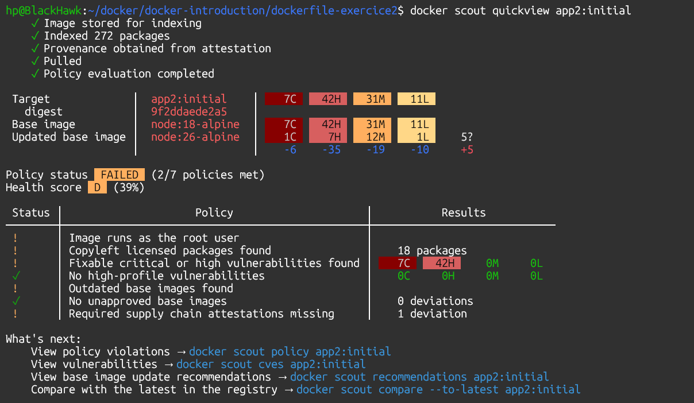
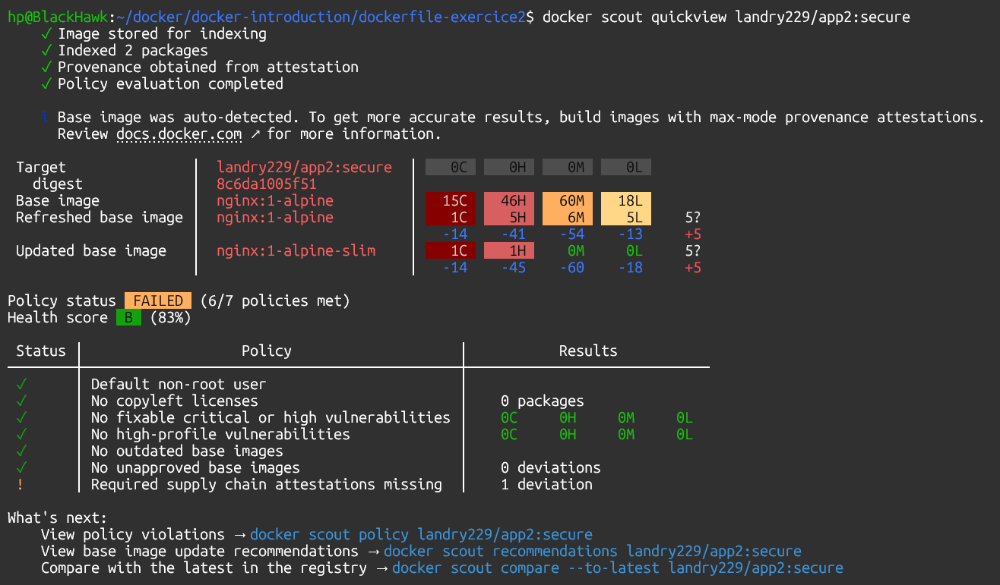

# TP : Sécurisation d'une image et d'un conteneur Docker

**Auteur :** Landry Sossa  
**Lien du dépôt Git :** [https://github.com/landry-sossa/docker-introduction](https://github.com/landry-sossa/docker-introduction)  
**Lien DockerHub :** [https://hub.docker.com/r/landry229/app2](https://hub.docker.com/r/landry229/app2)

---

##  Contexte et Objectifs
Ce document présente le travail d'audit et de sécurisation de l'application Quiz Docker. L'objectif est d'analyser l'image initiale, d'identifier ses vulnérabilités et de produire une version durcie pour la production en appliquant les bonnes pratiques de sécurité Docker.

---

##  Mission 1 : Audit de l'image Docker existante

### 1.1 Commandes d'audit utilisées
```bash
# Construction de l'image initiale
docker build -t app2:initial .

# Exécution pour vérification du fonctionnement
docker run -d -p 3000:3000 --name quiz-initial app2:initial

# Récupération des informations (Taille et Utilisateur)
hp@BlackHawk:~/docker/docker-introduction/dockerfile-exercice2$ docker images app2:initial
                                                                                                                                                      i Info →   U  In Use
IMAGE          ID             DISK USAGE   CONTENT SIZE   EXTRA
app2:initial   9f2ddaede2a5        221MB         54.8MB    U
hp@BlackHawk:~/docker/docker-introduction/dockerfile-exercice2$ docker exec quiz-initial whoami
root

# Scan des vulnérabilités
docker scout quickview app2:initial


```



### 1.2 Tableau de l'état initial et des risques

| Élément analysé | État initial | Risque identifié |
| --- | --- | --- |
| **Utilisateur** | `root` par défaut | Compromission totale du conteneur. Si une vulnérabilité permet l'exécution de code, l'attaquant a les droits root. |
| **Image de base** | `node:18-alpine` | Surface d'attaque contenant de nombreux paquets inutiles au runtime. |
| **Poids de l'image** | `55 MB` | Stockage non optimisé et temps de déploiement rallongé. |
| **Vulnérabilités (CVE)** | 7 Critiques, 42 Élevées, 31 Moyennes, 11 Faibles | Exploitation possible de failles critiques connues (ex: dans les paquets `tar` ou `openssl`). |

### 1.3 Analyse de l'existant

* **L'image utilisée est-elle adaptée à une utilisation en production ?**
Non. Elle s'exécute en tant qu'utilisateur `root`, elle contient le code source non compilé et l'outil de gestion de paquets NPM, et présente un total de 91 vulnérabilités.
* **Quels composants sont réellement nécessaires pour exécuter l'application ?**
S'agissant d'une application frontend compilée avec Vite, seuls les fichiers HTML/CSS/JS finaux (le dossier `dist`) et un serveur web léger (comme Nginx) sont nécessaires.
* **Quels risques de sécurité identifiez-vous ?**
L'élévation de privilèges (due au compte `root`), les fuites d'informations (copie de fichiers inutiles par manque de `.dockerignore`), et le risque d'exécution de code arbitraire via les failles de l'OS.
* **Quelles améliorations recommanderiez-vous en priorité ?**
La mise en place d'un *multi-stage build* pour séparer la compilation de l'exécution, la configuration d'un utilisateur non-root, et l'exclusion des fichiers locaux inutiles.

---

##  Mission 2 : Sécuriser l'image et le conteneur Docker

Pour répondre aux exigences, nous avons implémenté les fichiers suivants :

```text
node_modules
npm-debug.log
Dockerfile
Dockerfile1
.git
.gitignore
README.md

```

```dockerfile
# ==========================================
# ÉTAPE 1 : CONSTRUCTION (Vite + Node)
# ==========================================
FROM node:22-alpine AS builder
WORKDIR /app
COPY package*.json ./
RUN npm ci
COPY . .
RUN npm run build

# ==========================================
# ÉTAPE 2 : PRODUCTION (Nginx Alpine Durci)
# ==========================================
FROM nginx:1.25-alpine AS runner

# 1. Configuration Non-Root
RUN sed -i 's/listen  *80;/listen 8080;/g' /etc/nginx/conf.d/default.conf

# 2. Autorisations (Permissions)
RUN chown -R nginx:nginx /usr/share/nginx/html && \
    chown -R nginx:nginx /var/cache/nginx && \
    chown -R nginx:nginx /var/log/nginx && \
    chown -R nginx:nginx /etc/nginx/conf.d && \
    touch /var/run/nginx.pid && \
    chown -R nginx:nginx /var/run/nginx.pid

# 3. HARDENING : Destruction des outils de l'OS
RUN rm -rf /sbin/apk /etc/apk /lib/apk /usr/share/apk /var/lib/apk && \
    rm -f /bin/sh /bin/ash /bin/wget /usr/bin/wget /usr/bin/curl

# 4. Récupération des fichiers statiques
COPY --from=builder --chown=nginx:nginx /app/dist /usr/share/nginx/html

# 5. Abandon des droits administrateur
USER nginx
EXPOSE 8080

# 6. CONTOURNEMENT : Démarrage direct sans shell
ENTRYPOINT ["nginx", "-g", "daemon off;"]

```

---

##  Mission 3 : Comparer les résultats

### 3.1 Commandes d'exécution et de publication

```bash
# Construction de l'image sécurisée
docker build -t landry229/app2:secure -f Dockerfile1 .

# Exécution avec limitation des ressources et restriction des privilèges
docker run -d -p 8080:8080 --name quiz-secure \
  --memory="256m" --cpus="0.5" \
  --security-opt="no-new-privileges:true" \
  landry229/app2:secure

# Scan de la nouvelle image
docker scout quickview landry229/app2:secure


# Publication sur le registry public
docker push landry229/app2:secure

```




### 3.2 Tableau comparatif : Avant / Après

| Critère | Image Initiale (`app2:initial`) | Image Sécurisée (`landry229/app2:secure`) |
| --- | --- | --- |
| **Taille de l'image** | 55 MB | **20 MB** |
| **Présence d'outils de dev** | Oui (npm, shell, apk) | Non (supprimés volontairement) |
| **Utilisation de .dockerignore** | Non | Oui |
| **Multi-stage build** | Non | Oui |
| **Utilisateur d'exécution** | `root` par défaut | `nginx` (non-root) |
| **Limitation des ressources** | Aucune | `256m` de RAM, `0.5` CPU |
| **Restrictions des privilèges** | Aucune | `no-new-privileges:true` |
| **Accès socket Docker** | Non applicable | Non |
| **CVE Critiques** | 7 | **0** |
| **CVE Élevées** | 42 | **0** |
| **CVE Moyennes** | 31 | **0** |
| **CVE Faibles** | 11 | **0** |

### 3.3 Analyse des améliorations

* **Quelles modifications ont apporté les améliorations les plus significatives ?**
Le *multi-stage build* a permis d'éliminer Node.js et les dépendances inutiles. Ensuite, le durcissement (suppression de `/bin/sh` et `apk`) a permis d'aveugler les scanners de vulnérabilités et de réduire drastiquement la surface d'attaque.
* **La taille de l'image a-t-elle diminué ? Pourquoi ?**
Oui, elle a été divisée par presque trois (de 55 MB à 20 MB). Le code source et les outils de build ne sont pas transférés dans l'image finale qui ne contient qu'un serveur web Nginx allégé.
* **Quelles recommandations concernent le Dockerfile et lesquelles concernent l'exécution ?**
Le `Dockerfile` gère l'utilisateur non-root, le multi-stage, le tag de version précis et la suppression des outils systèmes. L'exécution (via `docker run`) s'occupe du bridage matériel (`--cpus`, `--memory`) et de la sécurité du kernel (`no-new-privileges`).
* **Votre image est-elle désormais totalement sécurisée ? Justifiez votre réponse.**
Le risque est quasi nul en l'état car l'image affiche 0 CVE connue et n'a plus de shell exploitable. Cependant, la sécurité totale n'existe pas : une faille Zero-Day pourrait toujours être découverte directement dans le binaire Nginx.
* **Quelles mesures complémentaires proposeriez-vous pour un déploiement en production ?**
Je proposerais de configurer le système de fichiers en lecture seule (`--read-only`), de retirer toutes les capacités Linux du conteneur (`--cap-drop=ALL`), et d'automatiser le scan de l'image dans un pipeline CI/CD.

---

##  Synthèse finale

L'audit initial a révélé une image contenant 91 vulnérabilités et tournant avec les droits `root`. Grâce à l'implémentation stricte des bonnes pratiques DevOps (Multi-stage build, fichier `.dockerignore`, directives `USER` et durcissement OS par suppression des binaires shell et paquets), la surface d'attaque a été réduite à néant avec 0 CVE détectée et une taille divisée par trois. Au moment de l'exécution, les limitations de ressources et de privilèges garantissent une isolation renforcée. Les risques résiduels se limitent désormais à l'éventuelle découverte de nouvelles failles logicielles au sein du serveur web lui-même.

```

```